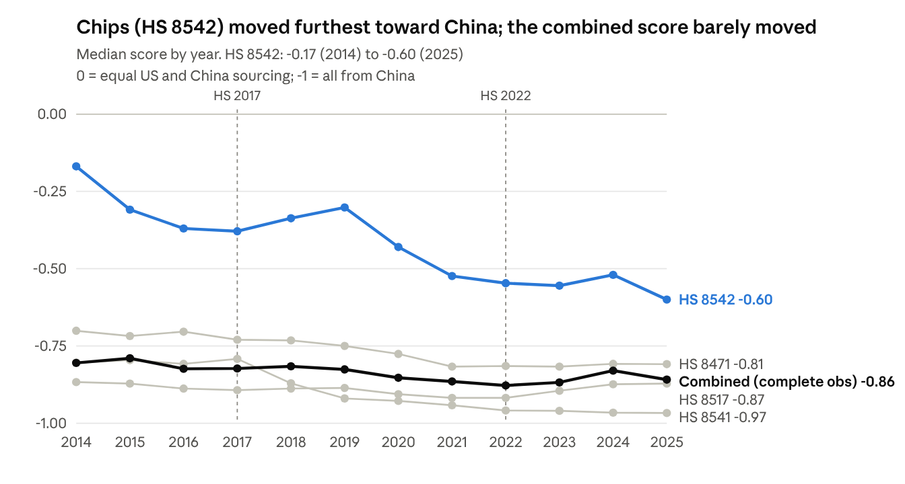

# Technology Pillar Findings Review

> **Exploratory work, not part of the official index.** This is Fazly's UN Comtrade comparison of
> technology-hardware imports from the US and China (HS 8471, 8517, 8541, 8542; 2014-2025), kept as a record of
> the analysis. It was proposed for team review but not adopted. The production experimental technology feature is
> built separately by `src/data/build_technology_trade.py` (UNCTAD ICT-goods list, TiVA domestic-value-added
> adjustment, 2004-2024). The official index and dashboard do not read any file listed here.

2026-11-01 · Fazly

**The indicator is valid if read narrowly: it measures where countries buy technology hardware that was made in the US or China, and on that measure almost every country sources overwhelmingly from China.** The median score is **−0.83**, and 88% of scored country-years are negative. The China tilt comes mainly from phones and telecom equipment (HS 8517), the largest category by value. Integrated circuits (8542) are the one category with a genuine US presence. The concern about solar panels in 8541 is real at category level but barely moves the combined score.

Confidence: high for the level and the cross-country ranking of medium and large economies; moderate for trends (a gentle drift toward China to about 2022, then a partial reversal); low for single-year jumps, partial-basket scores and small economies.

**Data basis.** 17 ZIP files (4 bulk China batches, 12 API slices for the US, 1 for China 2023), 16,094 rows, 15,421 after removing 673 duplicate rows. The panel has 2,256 country-years (188 countries × 2014–2025), of which **1,949 are scored**: 1,719 complete and 230 partial basket. I rebuilt the run from the raw files and the counts match the run on Fazly's machine exactly. All figures below come from the processed outputs and the diagnostic scripts on the `technology-pillar-comtrade` branch. Explanations for individual country movements are labelled as hypotheses.

## 1. Executive interpretation

**Technology-hardware sourcing is systematically China-oriented, and the pattern is stable.** Across 1,949 scored country-years the median is −0.834 and the mean −0.632. 80% of scores are below −0.5, and only 12% are above zero.

- **Distribution.** Scores pile up between −0.93 (25th percentile) and −0.61 (75th). 298 country-years are at or below −0.95. Only 23 are at or above +0.95, all of them small Caribbean or offshore economies.
- **Stability.** The share of negative scores stays between 84% and 91% in every year from 2014 to 2025. The median of complete observations ranges only from −0.79 to −0.88.
- **Movement.** There is a gentle drift toward China from 2014 to about 2022, then a partial reversal. The median of complete observations goes from −0.805 (2014) to −0.878 (2022), then −0.830 (2024). Of 132 countries with at least nine complete years, 103 have a downward trend and 29 an upward one. The typical slope is small (−0.006 a year).
- **Movement below zero matters.** Several countries remain negative but move noticeably toward the US. Netherlands goes from −0.59 to −0.47, Hungary from −0.74 to −0.48 and Australia from −0.79 to −0.57 by 2025. Others move toward China, for example Germany from −0.67 to −0.86 and South Korea from −0.61 to −0.80. These relative movements are the most informative part of the indicator.

A negative score here means "buys more hardware made in China than made in the US". It is not evidence of geopolitical alignment with China: Japan, Germany, the UK and Australia score between −0.57 and −0.88 in every year.

## 2. Category decomposition

**Telecom equipment (8517) drives the aggregate; integrated circuits (8542) behave differently; 8541 is the most China-skewed category but too small to matter for most countries.**

| HS | Median category score | Share of scores < 0 | Share ≤ −0.9 | Median share of a country's China imports | Median share of a country's US imports | Change in combined score if dropped (median Δ, share with Δ > 0.1) |
|---|---|---|---|---|---|---|
| 8471 Computers | −0.770 | 82% | 22% | 24% | 41% | 0.027, 15.5% |
| 8517 Telecom | −0.891 | 90% | 48% | 58% | 41% | 0.061, 32.8% |
| 8541 Semiconductor devices | −0.912 | 91% | 52% | 6% | 2% | 0.006, 6.3% |
| 8542 Integrated circuits | −0.420 | 70% | 14% | 0.9% | 3.5% | 0.004, 8.0% |

Category scores use all observed category cells (1,769–1,935 per HS). Value shares and drop-one changes use the 1,719 complete country-years.

- **8541 is unusually China-skewed,** and increasingly so: its median moves from −0.80 (2014) to −0.97 (2025). Chinese 8541 exports to reporters rose from US$27bn (2014) to US$68bn (2022) and then fell to US$45bn (2025). That rise and fall is consistent with the solar build-out, but this is a hypothesis: confirming it needs 6-digit data. Because 8541 is only about 6% of a typical country's China imports, dropping it changes the combined score by a median of 0.006.
- **8542 behaves differently.** It is the only category with a substantial share of US-oriented scores (30% positive). Pooled over all years, it is 46% of the US value in the matched basket but 21% of the China value. For most countries it is tiny (median 0.9% of China imports), so it barely affects their combined score. It dominates (40% or more of US+China value) only for chip-processing economies: Costa Rica, Hong Kong, Israel, South Korea, Malta, Malaysia, Philippines, Taiwan (S19), Singapore and Vietnam.
- **Computers and telecom dominate by volume.** Together they are about 80% of a typical country's China imports. A score built from 8471 and 8517 alone has a median of −0.860, against −0.836 for all four. In practice the combined score is close to a computers-and-telecom score.

## 3. Country examples

**The examples show that the score separates hardware supply chains, not allies.** Scores are combined scores for 2014 → 2025 unless noted.

| Pattern | Country | Score path | What drives it | What can be inferred | What cannot |
|---|---|---|---|---|---|
| Strongly China-oriented | Poland | −0.93 → −0.94 | All four categories near −0.9 | Hardware imports from the two anchors come almost entirely from China, every year | Anything about Poland's policy stance |
| Strongly China-oriented | Pakistan | −0.90 → −0.99 | Steady drift to near −1 | Growing reliance on Chinese-made hardware relative to US-made | Whether this reflects policy or price |
| US partner, China-sourced | Japan | −0.81 → −0.83 | 8471/8517/8541 near −0.9; 8542 near 0 (+0.31 → −0.20) | Japan's hardware imports are China-made even though it is a close US ally | That Japan leans toward China |
| US partner, drifting to China | South Korea | −0.61 → −0.80 | 8542 (about 65% of value) moved from −0.18 to −0.79 | Korea's chip imports increasingly come from China rather than the US | Why (fab relocation is a hypothesis) |
| US partner, drifting to China | Germany | −0.67 → −0.86 | 8542 moved from +0.34 to −0.63 | Chip sourcing shifted from US-made to China-made | Whether German firms changed suppliers or routing |
| Relatively balanced | Malaysia | −0.22 → −0.32 | 8542 (47–72% of value) near zero | Chip-processing hub with substantial two-way sourcing | Final use of the chips (much is processed and re-exported) |
| Relatively balanced | Mexico | −0.56 → −0.49 | 8471 and 8517 well above the category medians (8471 −0.22 to −0.69; 8517 −0.54 to −0.74) | US proximity shows in hardware sourcing | Integration effects in detail without more data |
| US-oriented | Israel | +0.67 (2014), +0.54 (2025) | 8542 positive in every year (+0.10 to +0.97) | Sources US-made chips and computers | Year-to-year level: see "suspicious" below |
| US-oriented, small | Bahamas, Bermuda, Cayman Islands | about +0.9 | US distribution networks (hypothesis) | Small economies buying through US channels | Much at all: bilateral totals are US$16–75m |
| Substantial change toward China | Philippines | +0.36 → −0.52 | 8542 (55–83% of value) moved from +0.62 to −0.31 | A real-looking shift in the main traded category, sustained over 11 years | The cause |
| Substantial change toward US | Netherlands | −0.59 (2014–16 avg) → −0.47 (2022–24 avg) | 8471 moved from −0.81 to +0.23; US computer imports rose from US$1.7bn (2022) to US$5.6bn (2025) | Computer sourcing moved toward US-made goods | Whether this is data-centre servers (hypothesis) |
| Suspicious | Israel | +0.37 (2017) → −0.47 (2018) → +0.20 (2020); +0.27 (2022) → −0.46 (2023) → +0.52 (2024) | 8471 and 8517 flip sign in single years on bilateral totals of US$1–3bn | The level is US-leaning in most years | Any single-year change; check reporting before use |
| Suspicious | Guatemala | +0.76 (2014–16 avg) → −0.61 (2022–24 avg) | 8471/8517 flip between 2020 and 2022; switch from HS 2017 to HS 2022 in 2022 | A shift happened | Whether it is real or a reporting or classification change |

Taiwan (code S19, "Other Asia, nes") scores between −0.54 and −0.70, with 8542 at about −0.6. It has no data for 2025 yet.

## 4. Time trends

**Sourcing drifted gently toward China until about 2022 and partly reversed afterwards; the clearest category trends are chips (8542) and semiconductor devices (8541).**

*Source: technology_trade_components.csv and technology_trade_orientation.csv · medians across countries, 2014–2025 · combined line uses complete country-years only*

- **Movers.** 132 countries have at least nine complete years in 2014–2024. Comparing the average of their first three years with their last three, 82 moved by less than 0.1. Among the 93 countries whose median US+China total is at least US$100m, 23 moved more than 0.1 toward China and 7 more than 0.1 toward the US. The largest moves toward the US are Iceland (+0.29), Hungary (+0.26), Jamaica (+0.24), Estonia (+0.16) and the Netherlands (+0.12). The largest toward China are Guatemala (−1.37), the Philippines (−0.62), Israel (−0.55) and Uruguay (−0.30).
- **2024–25 upturn.** This comes mostly from computers (8471). US computer imports rose between 2022 and 2025 in the Netherlands (US$1.7bn to US$5.6bn), Malaysia (US$0.15bn to US$3.7bn), Australia, Mexico, the UK and Japan. Data-centre server purchases are a plausible cause, but this is a hypothesis.
- **No break at HS revisions.** Most reporters moved to HS 2017 in 2017 and to HS 2022 in 2022–23. Year-on-year category changes are about the same size in a reporter's switch year as in other years (median absolute change: 8471 0.054 vs 0.053, 8517 0.029 vs 0.031, 8541 0.041 vs 0.044, 8542 0.131 vs 0.116). The medians show no step at either revision.
- **Large jumps are mostly data artefacts.** 55 country-years change by more than 0.5 from the year before. Of these, 39 involve a partial basket, 45 involve a US+China total under US$50m and 14 fall in an HS-switch year. Only 7 have none of these explanations: Israel (2018, 2020, 2023, 2024), Guatemala (2021), Iceland (2024) and Maldives (2024). Israel's sign flips in single years on totals of US$1–3bn need checking against Israel's own reporting before use.
- **2025 is incomplete.** It has 122 scored countries, against 162–177 in 2014–2023. Taiwan (S19), Vietnam and the UAE have not yet reported, so 2025 medians should be treated as provisional.

## 5. Structural China-bias diagnosis

**Yes, the indicator is structurally tilted toward China, but mostly because China really does make most of this hardware. That is a feature of the economic phenomenon, not a measurement flaw. The flaw would be reading it as alignment.**

| Candidate cause | Evidence from the data | Verdict |
|---|---|---|
| Real manufacturing-origin concentration in China | China's matched exports to reporters are 7.7 times the US's over 2014–2025 (US$6,547bn vs US$850bn). Every category is negative at the median | **Main driver.** A structural feature of the phenomenon |
| Composition of the basket | Phones and telecom (8517) are 58% of a typical country's China imports; dropping 8517 moves the score by more than 0.1 for 33% of country-years | **Strong amplifier.** The basket leans toward assembled consumer hardware |
| Dominance of particular categories | 8471 and 8517 alone give a median of −0.860 against −0.836 for all four | Confirms the above: the combined score is close to a computers-and-telecom score |
| 8541 solar | 8541 is the most China-skewed category (median −0.91) but only 6% of value; dropping it changes the combined score by a median of 0.006 | **Immaterial to the combined score;** material only for the 8541 category score |
| Low bilateral materiality | Cannot be measured without total (World) imports, which were not downloaded | **Unknown.** This is what Option C would test |
| Small denominators | Extreme scores (\|score\| ≥ 0.95) by size quintile: 10%, 20%, 27%, 21%, 4%. Only 51 scored country-years have a US+China total under US$1m, and 7 of them are extreme | **Not the main cause.** Most extremes are mid-sized economies buying almost all from China; near +1 scores are small Caribbean economies |
| Partial baskets | Partial scores are twice as often extreme (30% vs 15%) but are only 12% of scores; complete-only medians differ by at most 0.02 from all-score medians in any year | **Minor** (section 6) |
| Reporting artefacts | No systematic break at the 2017 or 2022 HS revisions; only 7 unexplained large jumps | **Minor,** confined to a few countries |
| Hong Kong as a hub | Hong Kong is 19–27% of pooled China imports, consistent with re-export trade. Removing it shifts the value-weighted aggregate from −0.72 to −0.69 (2014) and from −0.76 to −0.72 (2025) | Matters for value-weighted totals only; country scores are unaffected |

The distinction for the report: a negative score is a correct measurement of *where hardware is made*. It becomes misleading only if it is labelled as "technology alignment", because US-designed products assembled in China, and chips from Taiwan, Korea or Malaysia, never appear on the US side.

## 6. Partial-basket analysis

**Partial baskets are small economies with missing US chip or semiconductor rows. Their medians match complete scores, but they are twice as often extreme. Keep them with a flag, and leave single-category scores out of the headline.**

|  | Complete | Partial |
|---|---|---|
| Country-years | 1,719 | 230 |
| Median score | −0.836 | −0.814 |
| Mean score | −0.651 | −0.490 |
| Share extreme (\|score\| ≥ 0.95) | 14.7% | 30.0% |
| Share positive | 10.6% | 21.7% |
| Median US+China total | US$330m | US$7.7m |

- **Where they come from.** Of 348 missing category cells in partial country-years, 213 are 8541 or 8542 with the US side missing, and 51 more have both sides missing for those codes. Computers and telecom account for only 32. Because 8541 and 8542 are small in most countries' value (dropping either changes complete scores by a median of 0.004–0.006), a three-category score is probably close to what a full basket would give.
- **Who.** 51 countries, mostly small economies: São Tomé and Príncipe (12 years), Central African Republic (11), and Comoros, Mauritania, Montserrat, Lesotho, Tajikistan, Laos and Gambia (9 each). Larger cases include Iran (6) and Cuba (5).
- **When.** Partials fall over time, from 26 (2014) to 7 (2025), as reporting improves.
- **How many categories.** 133 are scored on 3 categories, 76 on 2 and 21 on 1. Single-category scores are extreme 52% of the time (median −0.937).

**Recommendation:** headline index = complete scores plus partial scores with at least 2 matched categories, flagged with `data_status`. Leave out the 21 single-category scores (they measure one product line, not the basket). Report complete-only as a robustness check; at the median it changes nothing. Never fill missing categories with zero. This threshold is a proposal for the team to approve, not something already in the code.

## 7. Options A–D evaluated with the results

**Adopt A and D now; defer B; treat C as the one worthwhile extra download if time allows.**

| Option | Problem it solves | Is the problem material in the data? | Worth changing the method? |
|---|---|---|---|
| **A.** Keep basket and formula; label it "Technology Hardware Sourcing Orientation" | Misreading negative scores as China alignment | **Yes.** 88% of scores are negative, including Japan, Germany, the UK and Australia | **Yes.** Costs nothing and changes no number |
| **B.** Remove solar sub-headings from 8541 | Solar inflating China's share | **Not for the combined score:** dropping all of 8541 changes it by a median of 0.006, and by more than 0.1 in only 6.3% of cases. Possibly for the 8541 category score (median −0.97 by 2025), but unproven without 6-digit data | **No,** not for the headline. Mention it as a limitation; optionally rerun the 8541 category with 6-digit data later |
| **C.** Add materiality = (US + China) / World | Not knowing how much of each country's sourcing the bilateral score covers (Taiwan, Korea, Malaysia and others are left out) | **Unknown.** Needs World-partner data. The pattern of chip hubs (Malaysia, Philippines, Singapore) and the absence of Taiwan and Korea as partners suggest coverage varies a lot | **Probably yes,** as an extra column, not a score change. One extra API pull (partner 0, same filters) |
| **D.** Show 8542 as a separate sub-indicator | The combined score hides the one category with real US presence | **Yes.** 8542 has a median of −0.42 against −0.84 combined, 30% positive scores, and the clearest trend (−0.17 to −0.60). It is under 1% of value for most countries, so it cannot show in the combined score | **Yes, as a view,** with no reweighting of the combined score |

For a time-constrained project: A plus D, plus the category breakdown and flags already in the outputs. C if one extra download fits in the timetable. B only as a note.

## 8. Methodological interpretation

**The indicator is not fundamentally invalid. It is valid for a narrow construct: the US–China split of technology-hardware imports by country of manufacture.**

Why it holds up:

- **It measures something real and stable.** The level is consistent year to year (median of complete scores within −0.79 to −0.88), and big year-on-year jumps are rare and mostly explained by data issues.
- **It discriminates.** Countries spread from about −1 (Pakistan, Poland, Iran) through the middle (Malaysia, Mexico, Canada) to positive (Israel, Costa Rica, Caribbean economies). The ordering matches known supply-chain geography.
- **It responds to change.** Shifts such as the Philippines' chip sourcing or Korea's and Germany's move in 8542 are sustained over several years, not one-year noise.
- **The feared distortions are small for the combined score.** Solar (8541), partial baskets, HS revisions and tiny denominators each change the headline little.

Where it would be invalid:

- **As an alignment measure.** The level is set mostly by where hardware is assembled, so Japan, Germany, the UK and Australia score −0.57 to −0.88.
- **As a measure of dependence.** It ignores third-country suppliers, so a country could score −1 while sourcing most of its chips from Taiwan.
- **As a combined "technology" score without its categories.** Chips (8542) behave differently and are invisible in the combined score for most countries.

In the wider index, a negative technology score next to a US-leaning voting or arms score is a real and useful divergence, provided the label makes clear what is being measured.

## 9. Recommended final presentation

**Show one headline score with its category breakdown and flags. Everything listed here except the materiality column already exists in the outputs.**

| Element | What to show | Status |
|---|---|---|
| Headline score | "Technology Hardware Sourcing Orientation", −1 to +1, from `technology_pillar_long.csv` | Ready (rename the indicator label) |
| Completeness flag | `data_status`; headline = complete + partial with ≥ 2 categories | Ready; threshold needs team approval |
| Category breakdown | The four category scores per country-year, from `technology_trade_components.csv` | Ready |
| Semiconductor view (8542) | 8542 score as a separate sub-indicator, with the chip-hub countries highlighted | Ready (filter of existing data) |
| Selected country histories | 4–6 countries: Japan or Germany (ally, China-sourced), Philippines (shift), Malaysia (balanced hub), Netherlands or Hungary (shift toward US), Mexico (US-adjacent) | Ready |
| Materiality (US+China share of World) | Extra column, not part of the score | Needs one API pull for partner 0 |
| Caveat box | One paragraph: country of origin, not brand; third countries excluded; 2025 provisional | Text in section 10 |

Leave out of the headline: single-category scores, and any reading of individual year-on-year jumps for Israel, Guatemala, Iceland or Maldives without checking.

## 10. Report-ready findings

**Findings**

1. Technology-hardware sourcing is overwhelmingly China-oriented: across 1,949 country-years (2014–2025) the median score is −0.83, and 88% of scores are negative.
2. The orientation is stable. It drifted slightly toward China until 2022 (median −0.81 to −0.88) and partly reversed in 2023–25, led by computers.
3. Telecom equipment (HS 8517) drives the aggregate: it is 58% of a typical country's imports from China, and a score built only from computers and telecom differs little from the four-category score.
4. Integrated circuits (HS 8542) are the exception: median −0.42, with 30% of scores favouring the US. They also show the strongest shift toward China, from −0.17 (2014) to −0.60 (2025).
5. Close US partners such as Japan, Germany, the UK and Australia source their hardware mainly from China (scores between −0.57 and −0.88). This is the kind of divergence from diplomatic orientation that a multidimensional index is meant to reveal.
6. Notable shifts include the Philippines (+0.36 to −0.52, driven by chips) and moves toward US sourcing in the Netherlands, Hungary and Iceland.
7. Solar products in HS 8541, partial baskets and HS revisions have little effect on the combined score, so the main pattern is robust to them.

**Methodology text**

The technology indicator measures the relative US–China split of each country's imports of four technology-hardware headings (HS 8471, 8517, 8541, 8542), using UN Comtrade reporter-side import data by country of origin. For each country-year, the score is (US − China) / (US + China), summed over the categories that both partners report, and ranges from −1 (all from China) to +1 (all from the US). Missing values are never treated as zero: scores are flagged when fewer than four categories are available, and the US and China themselves are not scored.

**Limitations text**

Because Comtrade attributes imports to the country of manufacture, US-designed products assembled in China count as Chinese, and supplies from third countries such as Taiwan, South Korea and Malaysia fall outside the comparison. The indicator therefore measures where technology hardware is made, not geopolitical alignment or overall dependence, and its level is structurally negative for most countries. Comparisons between countries and changes over time are more informative than the absolute level, and 2025 values are provisional because reporting is incomplete.
